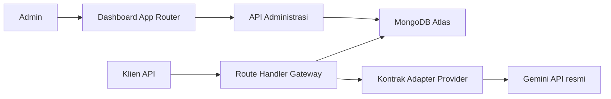
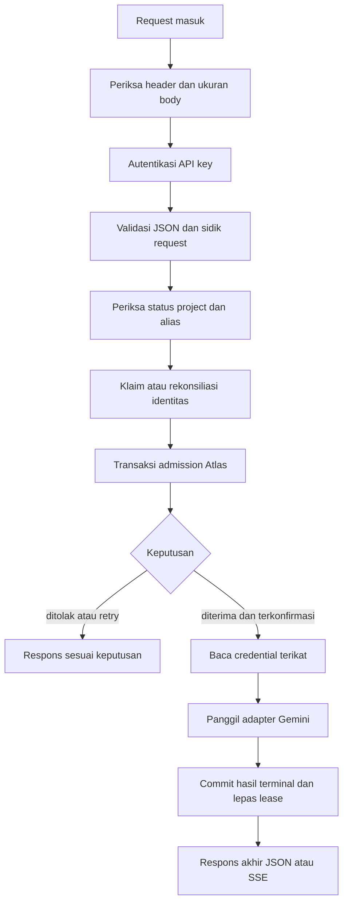
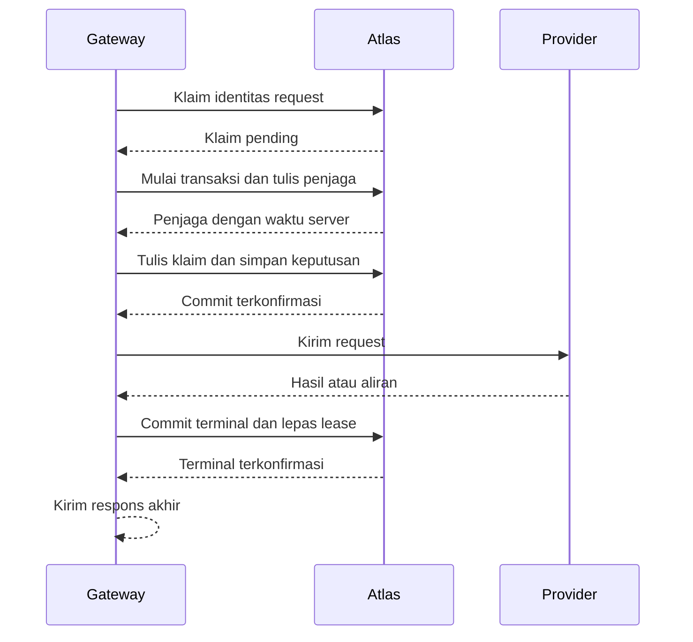
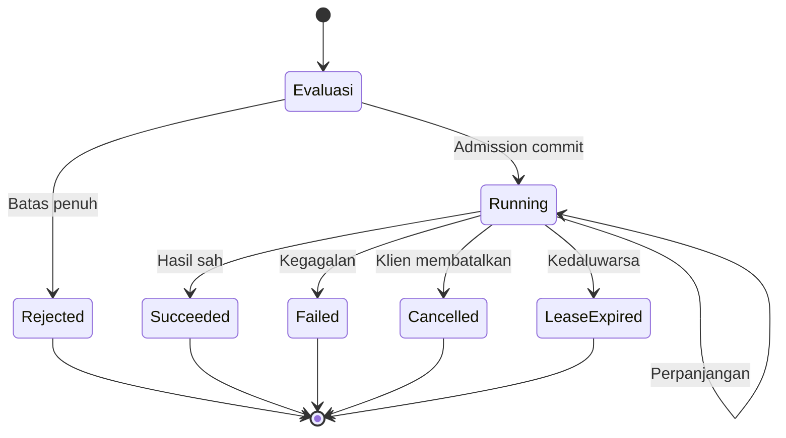

# Design Document

## Overview

Antigravity Gateway adalah satu aplikasi Next.js App Router dan TypeScript di Vercel yang terhubung langsung ke MongoDB Atlas. Aplikasi menyediakan dashboard khusus admin dan endpoint publik `POST /v1/chat/completions`. Gemini API resmi menjadi provider aktif pertama; kontrak adapter menjaga agar penambahan provider kelak tidak mengubah kontrak REST publik.

Desain ini mengikuti kontrak MVP dalam Requirements Document. Sebelum implementasi, Bayu dan Reza mencocokkan batas numerik, perilaku transaksi, dan acceptance criterion di dokumen ini dengan Requirement 5 dan `docs/PRD.md`. Perbedaan yang ditemukan diselesaikan sebelum validator dan pengujian batas dibuat. Integrasi Antigravity tetap berstatus `unsupported/pending_verification` sampai dokumentasi dan izin resminya terverifikasi.

| Milestone | Hasil desain dan implementasi | Penanggung jawab |
| --- | --- | --- |
| M1 | Foundation, indeks dan transaksi Atlas, sesi serta CSRF admin, pembatasan login, project, API key, credential terenkripsi | Bayu; review Reza |
| Prasyarat M2 | Deployment Vercel target mendukung runtime Node.js, Fluid Compute, dan `maxDuration` 660 detik; uji stream serta timeout di deployment tersebut lulus | Bayu; verifikasi Reza |
| M2 | Adapter Gemini, kontrak REST, admission terdistribusi, pemulihan klaim, lease, SSE | Bayu; review Reza |
| M3 | Pencatatan penggunaan, API monitoring, handoff dan dashboard admin | Bayu, Nala, Fira; review Reza |
| M4 | Flow YAML E2E, pengujian tambahan, verifikasi ulang deployment target, keputusan rilis | Reza; perbaikan Bayu dan Fira |

Prasyarat M2 dikerjakan setelah konfigurasi deployment tersedia dan **sebelum implementasi streaming M2 dimulai**. Paket target adalah Vercel Pro dengan Fluid Compute; batas fungsi dikonfigurasi eksplisit. Konfigurasi dan uji diulang bila paket atau pengaturan deployment berubah. Durasi fungsi mencakup waktu menunggu respons stream, dan `maxDuration` dapat diatur pada route Next.js. ([vercel.com](https://vercel.com/docs/functions/configuring-functions/duration?utm_source=openai))

## Architecture



Route Handler dan API administrasi berbagi modul akses Atlas, otorisasi, enkripsi, dan pencatatan operasional. Seluruh instance menggunakan database Atlas yang sama. Keputusan admission, status sesi, dan batas login tidak bergantung pada cache lokal.

Alur request gateway memisahkan pemeriksaan sebelum transaksi dari keputusan penerimaan yang harus konsisten lintas instance:



Pemeriksaan status sebelum transaksi memastikan key yang dicabut, project yang nonaktif, dan alias yang nonaktif mengalahkan keputusan retry lama. Pemeriksaan ulang **di dalam transaksi admission** menentukan apakah request baru boleh diterima. Jika credential terikat telah dicabut, admission ditolak sebelum provider dipanggil. Kegagalan dekripsi yang baru diketahui setelah admission menjadikan keputusan tersebut terminal `failed`; kuota rate yang telah diterima tetap terpakai. Pada SSE, chunk teks dapat dikirim selama pekerjaan berjalan; simpul respons akhir pada diagram berarti chunk akhir, event error terminal, atau `[DONE]`.

### Serialisasi per project dan waktu Atlas

`project_limiter_guards` memakai `_id` sama dengan ID project dan indeks unik bawaan `_id`. Pembuatan project membuat penjaganya dalam transaksi yang sama. Untuk project lama yang belum memiliki penjaga, operasi pertama menggunakan `upsert: true` dengan filter kesetaraan `_id`; tidak ada jalur yang membaca state limiter sebelum penulisan penjaga berhasil.

Setiap transaksi konfigurasi terkait project, admission, perpanjangan lease, pelepasan, dan penandaan lease kedaluwarsa menjalankan **operasi pertama** `findOneAndUpdate` pada penjaga tersebut. Update pipeline menetapkan `last_server_time: "$$NOW"` dan menaikkan `revision` satu kali; operasi meminta dokumen hasil pembaruan. Nilai `last_server_time` yang dikembalikan adalah waktu acuan transaksi itu. Seluruh perbandingan waktu dan perhitungan awal menit UTC di transaksi menggunakan **nilai tersebut**. Awal menit dihitung dengan `$dateTrunc` satuan `minute`, zona `UTC`. Penulisan penjaga menyerialkan transaksi yang memperebutkan state project yang sama. ([mongodb.com](https://www.mongodb.com/docs/manual/core/transactions-production-consideration/?utm_source=openai))

Transaksi memakai `readConcern: "snapshot"` dan `writeConcern: { w: "majority" }` pada tingkat transaksi, dengan pembacaan dan penulisan diarahkan ke primary. Tidak ada write concern tersendiri pada operasi di dalamnya. `TransientTransactionError`, konflik tulis, dan tabrakan indeks unik saat dua transaksi membuat penjaga yang sama menyebabkan **seluruh transaksi** diulang dari penulisan penjaga, dengan state dan waktu Atlas baru; retry dibatasi oleh tenggat admission.

Identitas `(project_id, api_key_id, request_id)` diklaim sebelum transaksi melalui `admission_intents` dengan penulisan majority dan indeks unik. Klaim berstatus `pending` memuat `attempt_id`, `generation`, `claimed_at`, dan `claim_expires_at`. Waktu klaim serta batas 30 detik dihitung oleh Atlas dengan `$$NOW`. Hanya pemilik pasangan `attempt_id` dan `generation` yang boleh menjalankan transaksi admission. Transaksi menulis penjaga sebagai operasi pertama, lalu **menulis** klaim dengan filter status `pending` serta pasangan pemilik tersebut. Jika tidak cocok, seluruh transaksi dibatalkan. Penulisan klaim ini adalah pagar terhadap pengambilalihan; pemeriksaan baca saja tidak cukup. Transaksi yang diterima mengubah klaim menjadi `committed` secara atomik bersama keputusan, rate, dan lease.

Rekonsiliasi berjalan saat retry menjumpai `pending` dan melalui pemindai berkala. Prosedurnya:

1. Baca klaim dan keputusan dari primary dengan read concern majority. Klaim `committed` atau `terminal` beserta keputusan dengan `attempt_id` yang cocok membuktikan admission telah commit. Gunakan keputusan itu; jangan membuat admission baru.
2. Bila klaim masih `pending` dan belum mencapai `claim_expires_at`, tunggu atau kembalikan `503 limiter_unavailable` sesuai tenggat request. Tidak adanya keputusan pada tahap ini **bukan** bukti abort.
3. Saat batas klaim tercapai, lakukan satu pembaruan atomik bersyarat pada klaim `pending` dengan `attempt_id` dan `generation` yang masih cocok serta `claim_expires_at` yang telah tercapai menurut waktu Atlas. Pembaruan majority menandai percobaan lama `fenced`, mencatat waktu dan ID percobaan yang dipagar, lalu memberikan `attempt_id` baru, menaikkan `generation`, dan membuat batas klaim baru. Hanya pemenang pembaruan ini yang boleh mencoba admission berikutnya. Proses lain membaca ulang klaim.
4. Jika pembaruan bersyarat gagal, baca ulang klaim dan keputusan. Commit lama yang menang akan terlihat sebagai `committed`; pengambilalihan lain yang menang akan terlihat melalui `generation` baru. Jika transaksi lama sedang memegang dokumen klaim, pembaruan menunggu penyelesaiannya atau mengalami konflik dan dicoba ulang.
5. Pembaruan pagar yang telah diakui majority membuktikan bahwa percobaan lama **tidak dapat lagi commit**. Jika transaksi lama sudah commit lebih dahulu, klaim bukan lagi `pending` sehingga pembaruan pagar gagal. Jika pagar commit lebih dahulu, transaksi lama yang wajib menulis klaim mengalami konflik tulis atau gagal mencocokkan pemilik. Bukti pemulihan adalah klaim berpagar yang diakui majority dan tidak adanya keputusan commit untuk pemilik lama; rekonsiliasi tidak mengandalkan hilangnya proses, pembacaan kosong, atau TTL sebagai bukti abort. Jika Atlas tidak dapat memastikan hasil pembaruan pagar, klaim tidak dibuka sampai hasilnya dapat dibaca dengan majority. ([mongodb.com](https://www.mongodb.com/docs/manual/core/transactions-production-consideration/?utm_source=openai))

Dengan prosedur ini, proses yang mati **sesudah klaim tetapi sebelum transaksi dimulai** meninggalkan `pending` paling lama sampai batas klaim dan rekonsiliasi dapat memagarnya saat Atlas sehat. Proses yang mati setelah transaksi mulai tetapi sebelum commit menghasilkan salah satu dari dua hasil: transaksi lama commit dan keputusannya dipakai, atau pagar menang dan transaksi lama tidak dapat commit. Proses yang mati setelah commit menghasilkan klaim serta keputusan `committed` yang dapat dibaca ulang. Tidak ada UUID yang menerima `503` tanpa batas karena klaim pra-transaksi yang ditinggalkan, selama Atlas tersedia dan transaksi yang memegang dokumen akhirnya selesai. Gangguan Atlas tetap dapat mempertahankan `503` sampai akses majority pulih.

Untuk `UnknownTransactionCommitResult`, gateway mengulang **commit transaksi yang sama** menurut mekanisme driver. Pembacaan majority pada primary yang menemukan keputusan beserta `attempt_id` yang sesuai membuktikan admission telah commit. Pembacaan yang belum menemukannya tidak membuktikan abort. Jika tenggat admission habis sementara hasil masih tidak pasti, gateway mengembalikan `503 limiter_unavailable` tanpa memanggil provider. Rekonsiliasi kemudian memakai prosedur klaim di atas; gateway tidak memulai transaksi kedua sebelum commit lama terlihat atau percobaan lama berhasil dipagar. MongoDB mendokumentasikan retry commit untuk hasil yang tidak diketahui. ([mongodb.com](https://www.mongodb.com/docs/v8.3/core/transactions-in-applications/?language-no-dependencies=motor&utm_source=openai))



Admission tepat terjadi saat transaksi commit. Provider hanya dipanggil setelah keputusan `running` milik request itu dipastikan. Jika kepastian tidak diperoleh sebelum batas waktu admission, responsnya `503 limiter_unavailable`. Lease dari admission yang ternyata telah commit tanpa panggilan provider dilepas saat dapat direkonsiliasi atau berakhir menurut batas waktunya.

### Siklus keputusan dan lease



Lease awal berlaku 45 detik dan diperpanjang sekurangnya setiap 15 detik selama pekerjaan aktif. Perpanjangan dan pelepasan menulis penjaga project. Lease hanya dapat diperpanjang bila `expires_at` **lebih besar** dari waktu server Atlas; pada batas tepatnya lease telah kedaluwarsa. Admission atau retry berikutnya menandai lease kedaluwarsa sebagai terminal dan mengabaikannya dalam hitungan slot, tanpa menunggu TTL database. Kegagalan atau ketidakpastian perpanjangan segera menghentikan pemrosesan keluaran, membatalkan upstream, dan membuang keluaran terlambat.

Penyelesaian hasil dan pelepasan lease berlangsung **dalam satu transaksi terminal**. Setelah menulis penjaga, transaksi wajib mencocokkan `attempt_id`, ID keputusan, dan ID lease milik pekerjaan tersebut, memastikan keputusan masih `running`, serta memastikan `expires_at` lease **lebih besar** dari waktu Atlas yang dikembalikan penjaga. Hanya bila seluruh syarat cocok transaksi boleh mengubah keputusan menjadi `succeeded`, `failed`, atau `cancelled`, mengisi `terminal_at` dan `dedupe_until`, memperbarui klaim menjadi `terminal`, dan melepas lease. Syarat ini berlaku juga untuk commit sukses nonstream dan SSE. Tepat pada `expires_at` maupun sesudahnya, transaksi terminal pekerja terlambat tidak boleh mengubah status atau melepas slot yang mungkin telah dipakai keputusan lain. Jalur penandaan `LeaseExpired` yang terpisah mengunci penjaga, memeriksa identitas lease dan keputusan, lalu mengubah keputusan yang masih `running` secara atomik.

Gateway harus memperoleh kepastian commit transaksi terminal **sebelum** mengirim respons sukses JSON, chunk akhir sukses SSE, atau `[DONE]`. Untuk SSE yang sudah dimulai, chunk teks boleh mendahului transaksi terminal, tetapi tidak menyatakan hasil sukses. Event error terminal dan `[DONE]` juga menunggu commit status `failed`. Jika transaksi terminal gagal karena lease sudah kedaluwarsa atau identitasnya tidak cocok, gateway membatalkan upstream, tidak mengirim penanda akhir sukses, dan membaca ulang keputusan untuk rekonsiliasi. Penghentian proses sebelum commit terminal terkonfirmasi dapat berakhir sebagai `LeaseExpired`; pada saat itu gateway belum mengirim penanda akhir sukses. Penghentian proses setelah commit terminal dapat menyebabkan klien menerima respons terpotong, sementara retry melaporkan hasil terminal yang sudah tersimpan. Status terminal menyatakan keputusan server yang sudah commit, bukan bukti penerimaan seluruh byte oleh klien.

## Components and Interfaces

| Komponen | Tanggung jawab dan antarmuka |
| --- | --- |
| Bootstrap admin | Perintah operator dengan akses lingkungan deployment dan Atlas. Menerima email dan kata sandi melalui input rahasia; membuat penjaga bootstrap ber-ID tetap dan admin ber-hash Argon2id dalam satu transaksi. Gagal bila admin awal sudah ada. |
| Autentikasi admin | Login dengan reservasi percobaan dan penghitung kegagalan bersama di Atlas; sesi acak yang hanya disimpan sebagai hash; pemeriksaan sesi dan hak admin terhadap Atlas pada setiap akses. |
| API administrasi | CRUD dan penonaktifan project, alias, API key, dan credential; konfigurasi batas; rotasi credential; monitoring. Setiap mutasi, termasuk logout, memerlukan `Origin` aplikasi dan `X-CSRF-Token` khusus sesi. Penerbitan ulang token CSRF memiliki pemeriksaan asal browser tersendiri. |
| Autentikasi gateway | Memeriksa bearer key dan status pencabutan, lalu menentukan identitas internal `api_key_id` dan project. Hash tersimpan tidak dapat dipakai sebagai bearer key. |
| Validator kontrak publik | Membatasi body hingga 1 MiB saat dibaca; memeriksa JSON, UUID idempotensi, field, batas nilai, dan urutan pesan sebelum admission. |
| Koordinator admission | Mengklaim dan memagar identitas request, merekonsiliasi hasil tidak pasti, menjalankan transaksi penjaga project, otorisasi ulang, deduplikasi, rate limit, concurrency, dan pencatatan keputusan. |
| Pengelola lease | Memperpanjang lease, membatalkan pekerjaan jika lease tidak sah, serta meng-commit hasil terminal dan pelepasan lease sebelum respons akhir. |
| Adapter provider | Antarmuka untuk validasi dan pemetaan pesan, pengiriman, normalisasi nonstream, akumulasi elemen streaming, pembatalan upstream, dan pemetaan kesalahan. Implementasi MVP memakai Gemini API resmi. |
| Penyaji SSE | Menunda header hingga teks pertama, mengirim chunk ber-ID tetap, lalu mengirim chunk akhir atau event error dan `[DONE]` setelah status terminal terkonfirmasi; menerapkan tenggat request 600 detik. |
| Pencatat operasional | Menyimpan metadata penggunaan tanpa bearer key, credential, atau isi pesan; membatasi catatan pra-autentikasi secara bersama. |
| Dashboard | Alur admin untuk project, key, credential, pengikatan alias, batas, dan monitoring berdasarkan handoff Nala; integrasi API oleh Fira. |

### Kontrak gateway

`POST /v1/chat/completions` menerima bearer API key project, JSON, dan `Idempotency-Key` berupa UUID. Field tingkat atas yang diterima hanya `model`, `messages`, `stream`, `temperature`, dan `max_tokens`. `stream` yang tidak dikirim bernilai `false`. Batas nilai yang divalidasi adalah **1 sampai 64 pesan**; **maksimum 32 KiB UTF-8 per konten**; `temperature` berupa angka **0 sampai 2, inklusif**; dan `max_tokens` berupa bilangan bulat **1 sampai 8192, inklusif**. Nilai di luar batas ditolak sebelum admission. Pemetaan `param` mengikuti Requirement 5. Field kemampuan di luar cakupan menghasilkan `unsupported_feature`; field tak dikenal menghasilkan `invalid_request`. Tidak ada kegagalan validasi yang memanggil provider.

Pesan `system` hanya boleh berada di awal, diikuti `user` pertama, kemudian `assistant` dan `user` bergantian, dengan `user` sebagai pesan terakhir. Adapter mempertahankan setiap bagian teks dan urutannya: `system` awal menjadi `systemInstruction` Gemini, `user` menjadi peran Gemini `user`, dan `assistant` menjadi peran Gemini `model`. `temperature` yang hadir dipetakan tanpa perubahan nilai ke `generationConfig.temperature`; `max_tokens` yang hadir dipetakan ke `generationConfig.maxOutputTokens`. Field yang tidak hadir tidak dikirim sehingga berlaku pengaturan provider. Adapter meminta satu kandidat; bila provider tetap mengirim lebih dari satu, hanya kandidat pada indeks `0` yang digunakan. Kandidat lain tidak digabungkan dan tidak mengubah hasil kandidat pertama. ([ai.google.dev](https://ai.google.dev/api/generate-content?authuser=01&hl=en&utm_source=openai))

Alias menyimpan project pemilik, ID credential Gemini yang terikat secara eksplisit, nama model Gemini aktual, dan status. Adapter selalu memakai credential yang terikat; tidak ada pemilihan credential cadangan. Respons publik tetap memakai nama alias yang diminta.

**Normalisasi respons nonstream** dilakukan setelah respons lengkap diterima:

1. Jika `promptFeedback` menunjukkan blokir, hasilnya `provider_output_blocked`, termasuk ketika `candidates` kosong.
2. Jika kandidat indeks `0` tidak ada tanpa tanda blokir, hasilnya `provider_empty_response`. Jika `finishReason` kandidat itu menunjukkan blokir atau penolakan, hasilnya `provider_output_blocked`.
3. Dari `content.parts` kandidat indeks `0`, adapter mengambil setiap `text` bertipe string sesuai urutan dan menggabungkannya **tanpa pemisah tambahan**. Bagian nonteks, termasuk pemanggilan fungsi, gambar, dan data inline, tidak diubah menjadi teks. Jika keluaran hanya berisi bagian nonteks, hasilnya `provider_error`; jika tidak ada bagian atau seluruh teks kosong, hasilnya `provider_empty_response`.
4. `finishReason: STOP` menjadi `stop`, dan `MAX_TOKENS` menjadi `length`. Alasan selesai lain, hilang pada respons final, atau belum dikenal menjadi `provider_error`, kecuali alasan blokir yang menjadi `provider_output_blocked`. Teks yang sempat diterima tidak membuat hasil tersebut sukses.

Sebagai contoh, bagian teks `"Halo"` dan `" dunia"` menghasilkan `"Halo dunia"`; bagian teks `"Halo"` diikuti bagian nonteks menghasilkan `"Halo"` bila alasan selesai `STOP`. `candidates: []` tanpa tanda blokir menghasilkan `provider_empty_response`; kandidat dengan `finishReason: SAFETY` menghasilkan `provider_output_blocked`; kandidat bertulisan `"Halo"` dengan alasan selesai `OTHER` menghasilkan `provider_error`. Daftar alasan selesai dan sinyal blokir mengikuti dokumentasi Gemini; kode kesalahan tersebut adalah keputusan kontrak gateway. ([ai.google.dev](https://ai.google.dev/api/generate-content?authuser=01&hl=en&utm_source=openai))

Untuk nonstream yang berhasil, penyaji meng-commit status `succeeded` dan pelepasan lease terlebih dahulu, kemudian menghasilkan satu `choices`, `object: "chat.completion"`, ID respons, timestamp Unix detik, alasan selesai `stop` atau `length`, dan `usage` terukur atau `null`. Token dari metadata penggunaan Gemini dipakai hanya bila tersedia dan sah.

**Normalisasi stream** memisahkan pemrosesan elemen sementara dari keputusan final:

1. Adapter memproses elemen provider berurutan. Dari kandidat indeks `0` yang **ada** pada suatu elemen, setiap bagian `text` bertipe string menjadi tambahan teks dan menghasilkan satu chunk teks sesuai urutannya. Bagian nonteks dicatat sebagai keluaran nonteks tanpa diubah menjadi teks. Kandidat yang tidak ada, elemen metadata saja, dan elemen dengan teks tetapi tanpa `finishReason` adalah keadaan sementara yang sah; tidak satu pun langsung menjadi error.
2. Adapter mengumpulkan sinyal `promptFeedback`, keberadaan kandidat indeks `0`, keberadaan teks dan bagian nonteks, metadata penggunaan, serta `finishReason` yang muncul. `finishReason` kosong pada elemen sementara berarti model mungkin masih menghasilkan token. Sinyal selesai yang saling bertentangan menghasilkan `provider_error` pada evaluasi final. ([ai.google.dev](https://ai.google.dev/api/generate-content?authuser=01&hl=en&utm_source=openai))
3. **Saat stream provider berakhir**, adapter mengevaluasi hasil akumulasi: blokir atau penolakan menghasilkan `provider_output_blocked`; tidak pernah ada kandidat indeks `0` atau tidak ada teks maupun bagian nonteks menghasilkan `provider_empty_response`; hanya bagian nonteks menghasilkan `provider_error`; teks dengan `STOP` atau `MAX_TOKENS` yang konsisten menghasilkan sukses `stop` atau `length`; teks dengan alasan selesai lain, alasan tidak dikenal, atau tanpa alasan selesai final menghasilkan `provider_error`. Teks parsial tidak mengubah error menjadi sukses.
4. Header SSE baru dibuka setelah teks pertama yang sah tersedia. Urutan sukses adalah chunk peran `assistant`, chunk teks segera saat tersedia, **commit terminal `succeeded` beserta pelepasan lease**, chunk akhir dengan alasan selesai yang telah dipastikan, lalu tepat satu `[DONE]`. ID dan timestamp konsisten sepanjang satu respons. Error yang diputuskan sebelum teks pertama menghasilkan JSON setelah status terminal `failed` terkonfirmasi; error setelah stream dimulai menghasilkan satu event error dan satu `[DONE]` setelah commit `failed`. Koneksi yang dibatalkan klien tidak mendapat keluaran tambahan. Jika commit terminal belum pasti, gateway tidak mengirim penanda akhir.

Route gateway memakai runtime Next.js `nodejs` dan `export const maxDuration = 660`. Batas waktu nonstream adalah 120 detik dan batas total request stream adalah **600 detik sejak request diterima**, termasuk validasi, admission, dan streaming. Pada detik ke-600 gateway menghentikan pembacaan serta pengiriman teks dan membatalkan upstream, lalu menyediakan hingga 30 detik untuk meng-commit hasil terminal dan melepas lease. Setelah commit terkonfirmasi, gateway mengirim error atau menutup stream sesuai keadaan koneksi. Sisa 30 detik adalah ruang untuk pengiriman dan variasi jadwal fungsi sebelum batas Vercel 660 detik. Jika cleanup tidak dapat dipastikan, gateway tidak mengirim penanda terminal; lease 45 detik membatasi masa slot dan kegagalan dicatat. Pengujian pada deployment Pro target dengan Fluid Compute dan `maxDuration` efektif 660 detik adalah prasyarat implementasi streaming M2. ([vercel.com](https://vercel.com/docs/functions/configuring-functions/duration?utm_source=openai))

### Kontrak administrasi

Cookie sesi bernama `__Host-admin_session` dengan `HttpOnly`, `Secure`, `SameSite=Strict`, dan `Path=/`. Sesi berakhir paling lambat 12 jam sejak dibuat atau setelah 30 menit tanpa aktivitas. Aktivitas sah memperbarui waktu aktivitas terakhir di Atlas. Logout dan pencabutan menandai sesi di Atlas sebelum request administrasi berikutnya diperiksa.

Saat login berhasil, server membuat token CSRF acak 256 bit dan menyimpan **hash token** sebagai verifikator pada dokumen sesi baru. Respons login mengirim token mentah sekali dalam body JSON melalui HTTPS, bersama cookie sesi `HttpOnly`; respons memakai `Cache-Control: no-store`. Dashboard menyimpan token hanya di memori aplikasi, tidak dalam cookie, `localStorage`, `sessionStorage`, URL, atau log.

Setelah pemuatan ulang halaman, dashboard mengambil token untuk sesi yang masih sah melalui `GET /api/admin/csrf` dengan `fetch` dari origin aplikasi dan cookie sesi. Endpoint memeriksa sesi dan asal request. Jika `Origin` hadir, nilainya harus sama persis dengan origin aplikasi. Jika tidak hadir, endpoint menerima `Sec-Fetch-Site: same-origin`; bila header itu juga tidak tersedia, endpoint menerima `Referer` hanya jika origin URL-nya sama persis dengan origin aplikasi. Header asal yang hadir tetapi bertentangan menyebabkan penolakan; `same-site`, `cross-site`, `Origin: null`, dan request tanpa satu pun bukti asal yang diterima juga ditolak. Origin aplikasi berasal dari konfigurasi tepercaya, bukan header host yang dikirim klien. Endpoint tidak mengaktifkan CORS lintas origin, mengirim token baru dalam body JSON dengan `Cache-Control: no-store`, serta mengganti verifikator sesi secara atomik. Penerbitan ulang membatalkan token sebelumnya. Aturan ini dapat dipenuhi oleh `GET` browser dari halaman dengan origin sama meskipun browser tidak mengirim `Origin`; JavaScript tidak perlu mengisi header tersebut sendiri. ([developer.mozilla.org](https://developer.mozilla.org/en-US/docs/Web/HTTP/Reference/Headers/Sec-Fetch-Site?utm_source=openai))

Login ulang, rotasi sesi, logout, dan pencabutan sesi juga membatalkan token lama. Setiap mutasi memeriksa `Origin` aplikasi, sesi, dan kecocokan `X-CSRF-Token` dengan verifikator sesi menggunakan perbandingan waktu konstan. Token dari sesi lain ditolak meskipun kedua sesi milik admin yang sama.

Pembatasan login menghitung kegagalan dalam jendela berjalan 15 menit, termasuk email tak terdaftar: paling banyak lima per email ternormalisasi dan 20 per IP sumber tepercaya. Pada deployment Vercel yang menerima lalu lintas langsung, sumber IP adalah header `x-vercel-forwarded-for` yang ditetapkan ingress Vercel; aplikasi tidak mempercayai `Forwarded`, `X-Real-IP`, atau header klien lain. Deployment melalui proxy tambahan memerlukan konfigurasi ingress tepercaya tersendiri dan verifikasi sumber sebelum login diaktifkan. Nilai harus berupa satu alamat IPv4 atau IPv6 yang valid; IPv4-mapped IPv6 dinormalisasi ke IPv4, IPv6 ke bentuk kanonis, dan port, daftar alamat, serta nilai ambigu ditolak dengan `503`.

Sebelum memeriksa kata sandi, transaksi Atlas menulis dua dokumen penjaga identitas, email lalu IP, dalam urutan tetap; membersihkan kegagalan yang sudah di luar jendela; dan membuat reservasi dengan `attempt_id` yang sama pada kedua identitas hanya bila `kegagalan + reservasi aktif` masih di bawah batasnya. Indeks unik identitas serta konflik tulis membuat percobaan serentak di instance berbeda mengulang transaksi dengan hitungan terbaru. Reservasi berlaku 30 detik menurut waktu Atlas.

Setelah verifikasi kata sandi, transaksi penyelesaian kembali menulis kedua penjaga dalam urutan yang sama. Transaksi **wajib** mencocokkan `attempt_id` pada kedua reservasi, memastikan keduanya belum dikonsumsi, dan memastikan kedua batas reservasi **lebih besar** dari waktu Atlas transaksi. Tepat pada batas 30 detik, penyelesaian sudah terlambat. Jika salah satu syarat gagal, seluruh transaksi dibatalkan: keberhasilan verifikasi yang terlambat tidak membuat sesi atau token CSRF; klien menerima `409 login_attempt_expired` dan dapat memulai percobaan baru. Dua penyelesaian yang bersaing untuk `attempt_id` sama tidak dapat sama-sama berhasil.

Jika syarat cocok, transaksi secara atomik mengonsumsi kedua reservasi. Kegagalan menambah satu cap waktu kegagalan pada tiap identitas; keberhasilan menghapus reservasi dan kegagalan email, mempertahankan kegagalan IP, serta membuat dokumen sesi baru dalam **transaksi yang sama**. Reservasi kedaluwarsa dihitung sebagai tepat satu kegagalan pada email dan IP sebelum slotnya dapat dipakai lagi. Pembersihan ini juga menggunakan `attempt_id` sehingga tidak dapat menghitung kegagalan dua kali atau mengonsumsi reservasi baru. Kegagalan Atlas atau sumber IP yang tidak dapat dipercaya menghasilkan `503`, tanpa pemeriksaan kata sandi.

## Data Models

| Koleksi atau dokumen | Field utama | Indeks dan aturan |
| --- | --- | --- |
| `bootstrap_guard` | ID tetap, waktu pembuatan | ID unik; dibuat bersama admin awal dalam satu transaksi. |
| `admins` | ID, email ternormalisasi, hash Argon2id, status hak admin | Email unik. |
| `admin_sessions` | Hash token sesi, ID admin, dibuat, kedaluwarsa absolut, aktivitas terakhir, status pencabutan, hash token CSRF | Hash token sesi unik; dibuat hanya oleh transaksi penyelesaian login yang sah; verifikator CSRF diganti atomik saat token diterbitkan ulang. |
| `login_failures` | Jenis serta identitas email atau IP kanonis, daftar waktu kegagalan, reservasi aktif dengan `attempt_id` dan batas waktu | Indeks unik `(jenis, identitas)`; penyelesaian mensyaratkan reservasi sah pada kedua identitas; kedaluwarsa dihitung sekali sebagai kegagalan. |
| `projects` | ID, status, batas rate, batas concurrency | Nilai awal 60 request per menit UTC dan lima request aktif; perubahan hanya bilangan bulat positif. |
| `api_keys` | ID internal, ID project, hash satu arah, metadata pengenalan, waktu pencabutan | Secret dibuat dengan sedikitnya 256 bit acak dan hanya diperlihatkan sekali. Hash tersimpan bukan token bearer. |
| `provider_credentials` | ID, ID project, jenis provider, status, ciphertext, nonce, tag autentikasi, versi kunci | Enkripsi terautentikasi; kunci berversi berasal dari secret lingkungan di luar Atlas. |
| `model_aliases` | ID, ID project, alias, model Gemini aktual, ID credential terikat, status | Alias unik dalam project; pengikatan hanya ke credential Gemini aktif milik project tersebut. |
| `project_limiter_guards` | `_id` project, `revision`, `last_server_time` | `_id` unik; dibuat bersama project atau melalui upsert pada operasi pertama transaksi. |
| `rate_counters` | ID project, awal menit UTC, jumlah admission | Unik per project dan menit; hanya admission yang commit menaikkan hitungan. |
| `rejection_counters` | ID project, hari UTC, jumlah keputusan `rejected` baru | Unik per project dan hari; maksimum 1.000 pencatatan per hari UTC. |
| `admission_intents` | ID project, ID API key, UUID request, `attempt_id`, `generation`, status `pending`, `committed`, atau `terminal`, `claimed_at`, `claim_expires_at`, penanda percobaan berpagar, `dedupe_until` bila terminal | Indeks unik `(project_id, api_key_id, request_id)`; `pending` tidak dihapus otomatis; pengambilalihan memakai pembaruan bersyarat dan majority; transaksi admission wajib menulis pasangan pemilik aktif. |
| `admission_decisions` | ID project, ID API key, UUID request, `attempt_id`, sidik payload, status, waktu keputusan, hasil asal, waktu terminal, `dedupe_until` | Indeks unik `(project_id, api_key_id, request_id)`; keputusan terminal berlaku untuk deduplikasi hingga tepat 24 jam setelah `terminal_at`. |
| `concurrency_leases` | ID lease, ID project, ID keputusan, `expires_at` | Lease unik; hanya lease dengan `expires_at` lebih besar dari waktu server Atlas dihitung aktif; transaksi terminal wajib mencocokkan ID dan batas waktunya. |
| `usage_records` | Waktu mulai, durasi, HTTP status, hasil, kode error, ID project, alias, provider, token terukur jika tersedia | Alias dan provider `null` bila belum diketahui; tanpa rahasia atau isi pesan. |
| `preauth_rejection_counters` dan catatan terkait | Menit UTC, jumlah, serta metadata penolakan individual yang diizinkan | Maksimum 1.000 catatan per menit UTC lintas instance; catatan individual dihapus paling lambat tujuh hari. |

Sidik request dihitung dari payload yang sudah valid: alias `model`, urutan dan nilai `role` serta `content` setiap pesan, `stream`, dan keberadaan serta nilai `temperature` dan `max_tokens`. Representasi kanonis mengabaikan urutan field objek, membandingkan angka menurut nilainya, dan menganggap `stream` yang tidak dikirim sama dengan `false`. Tidak ada normalisasi Unicode tambahan. Nilai konfigurasi alias, nama model Gemini aktual, dan credential tidak masuk sidik.

Identitas request yang berstatus `running` tetap dicadangkan sampai terminal. Saat keputusan menjadi terminal, transaksi menetapkan `terminal_at` dari waktu penjaga Atlas dan `dedupe_until = terminal_at + 24 jam` pada keputusan dan klaim. Sebelum `dedupe_until`, retry memakai keputusan lama; **tepat pada atau setelah** waktu itu, UUID boleh dipakai kembali untuk admission baru. Klaim baru menggunakan pembandingan atomik terhadap klaim terminal yang telah melewati `dedupe_until`. Dalam transaksi admission berikutnya, keputusan lama dihapus lalu keputusan baru dengan kunci unik yang sama dibuat secara atomik. Klaim `pending` dari commit yang belum pasti tidak memenuhi syarat penggunaan ulang sampai percobaan lama telah dipagar secara sah. TTL boleh membersihkan keputusan terminal setelah `dedupe_until`, tetapi ketepatan jendela tidak bergantung pada kapan TTL berjalan. UUID yang dipakai kembali dapat membawa payload berbeda setelah jendela berakhir.

Keputusan `rejected` dicatat sebagai terminal tanpa kenaikan rate atau lease selama kuota pencatatan hariannya tersedia. Setelah kuota pencatatan habis, gateway tetap memberi `429` tanpa menyimpan keputusan baru atau memberi `outcome`; klaim percobaan diselesaikan tanpa meninggalkan status `pending`. Keputusan yang masih berada dalam jendela deduplikasi selalu diperiksa lebih dahulu.

Rotasi kunci menetapkan versi aktif untuk enkripsi baru, mempertahankan versi lama untuk membaca ciphertext lama, lalu menjalankan migrasi dan verifikasi sebelum versi lama dinonaktifkan. Versi hilang, kunci salah, atau autentikasi ciphertext gagal menyebabkan `provider_unavailable` tanpa penggunaan plaintext pengganti.

## Error Handling

Semua kesalahan sebelum respons dimulai menggunakan bentuk berikut:

```json
{
  "error": {
    "message": "Pesan aman.",
    "type": "jenis_kesalahan",
    "param": null,
    "code": "kode_kesalahan"
  }
}
```

| Kondisi | HTTP dan kode | Perilaku |
| --- | --- | --- |
| Key tidak ada, salah, atau dicabut | `401` | Tanpa admission atau panggilan provider. |
| Project atau alias nonaktif | `403 project_disabled` atau `403 model_disabled` | Diperiksa sebelum keputusan retry lama; tanpa `outcome`. |
| Alias tidak terdaftar pada project | `404 model_not_found` | Tidak mengungkap alias project lain. |
| JSON, UUID, struktur, atau nilai tidak valid | `400 invalid_request` | `param` menunjuk field yang gagal. |
| Fitur dikenal di luar cakupan MVP | `400 unsupported_feature` | `param` menunjuk field tersebut. |
| Body melebihi 1 MiB | `413 payload_too_large` | Pembacaan dihentikan; `param: null`. |
| Rate atau concurrency penuh | `429 rate_limit_exceeded` atau `429 concurrency_limit_exceeded` | Rate dipilih jika keduanya penuh. `Retry-After` mengikuti jendela rate atau bernilai `1` untuk concurrency. |
| Sidik berbeda pada identitas request yang sama selama jendela deduplikasi | `409 idempotency_conflict` | Tanpa lease atau panggilan provider baru. |
| Keputusan lama masih berjalan dengan lease sah | `409 request_in_progress` | Tanpa admission baru. |
| Keputusan lama terminal selain `rejected` dan belum kedaluwarsa | `409 request_already_processed` | Menyertakan `outcome`; tanpa isi hasil model. |
| Penyelesaian login melewati batas reservasi atau kalah dari penyelesaian lain | `409 login_attempt_expired` | Tanpa sesi atau token CSRF baru; reservasi kedaluwarsa dihitung sekali sebagai kegagalan. |
| Credential terikat dicabut, hilang, atau tidak dapat dipakai | `503 provider_unavailable` | Tidak beralih credential dan tidak memanggil provider. |
| Provider menolak atau gagal | `502 provider_error` | Rahasia tidak muncul pada respons atau log. |
| Keluaran diblokir, kosong, hanya nonteks, atau alasan selesai tak dikenal | `502 provider_output_blocked`, `502 provider_empty_response`, atau `502 provider_error` | Untuk stream, diputuskan setelah aliran provider berakhir; teks parsial tidak ditandai sukses. |
| Atlas atau state limiter tidak tersedia, klaim masih `pending`, atau admission tak dapat dipastikan | `503 limiter_unavailable` | Tidak memanggil provider tanpa admission terkonfirmasi; rekonsiliasi memagar klaim yang melewati batasnya sebelum admission baru. |
| Timeout gateway | `504 gateway_timeout` sebelum header; event error setelah header SSE | Membatalkan upstream dan mengupayakan commit terminal dalam ruang cleanup. |

Retry keputusan `rejected` yang tercatat dan belum kedaluwarsa mengembalikan `429` dan kode asal beserta `outcome`. Untuk penolakan rate, `Retry-After` dihitung ulang sampai akhir jendela asal dan dihilangkan setelahnya; penolakan concurrency tetap memakai `Retry-After: 1`. Retry terminal lain mengembalikan `outcome` berisi `status`, `original_http_status`, `original_error_code` atau `null`, dan `completed_at`. `succeeded` pada stream berarti hasil terminal telah commit dan chunk akhir serta `[DONE]` siap dikirim, tanpa menjamin semua byte diterima klien.

Jika kesalahan terjadi setelah HTTP `200` SSE dimulai, gateway lebih dahulu meng-commit status terminal `failed` dan pelepasan lease, dengan syarat identitas serta masa berlaku lease yang sama seperti commit sukses. Setelah commit terkonfirmasi, gateway mengirim satu event `data` berisi objek `error`, lalu tepat satu `[DONE]` dan menutup stream. Pada timeout stream, proses ini dimulai pada detik ke-600 sebelum fungsi mencapai `maxDuration` 660 detik. Pada pembatalan klien, koneksi yang telah tertutup tidak menerima event atau `[DONE]` tambahan. Semua jalur terminal membatalkan pekerjaan upstream yang masih aktif dan mengabaikan keluaran terlambat. Jika lease telah kedaluwarsa, gateway merekonsiliasi keputusan `LeaseExpired` dan tidak mengirim penanda akhir berdasarkan transaksi terminal pekerja yang gagal. Jika commit cleanup tidak dapat dipastikan dalam anggaran 30 detik, fungsi berhenti mengirim keluaran terminal dan menutup koneksi bila masih terbuka; lease berakhir menurut `expires_at`, dan kejadian itu dicatat. Gateway tidak pernah mengirim respons sukses JSON, chunk akhir sukses SSE, event error terminal, atau `[DONE]` berdasarkan transaksi terminal yang masih belum pasti. Kegagalan pencatatan operasional tidak mengubah respons gateway yang sudah dapat ditentukan.

## Testing Strategy

Reza memetakan setiap flow minimum dan pengujian tambahan wajib pada Requirement 11 ke acceptance criterion yang spesifik. E2E menggunakan format flow YAML dan runner yang berlaku di workspace. Assertion mencakup status HTTP, isi JSON atau urutan SSE, perubahan state Atlas, serta jumlah panggilan provider saat relevan.

| Area verifikasi | Bukti utama dan gerbang |
| --- | --- |
| Foundation dan admin | Build lokal dan Vercel, koneksi serta transaksi Atlas, indeks unik, dua bootstrap serentak, atribut cookie, sesi lintas instance, login hingga mutasi pertama, dan penerbitan ulang CSRF setelah **reload halaman di browser nyata**. Uji `GET /api/admin/csrf` dari halaman dengan origin sama tanpa `Origin`, dengan `Sec-Fetch-Site: same-origin`, fallback `Referer`, header asal yang bertentangan, permintaan lintas origin, token lama setelah rotasi, token sesi lain, logout, serta pencabutan. Uji header IP palsu, IPv4-mapped IPv6, IP ambigu, kegagalan login serentak lintas instance, dan pemulihan reservasi setelah proses mati. Tambahkan verifikasi kata sandi yang selesai tepat pada dan sesudah batas 30 detik, serta dua penyelesaian bersaing untuk satu `attempt_id`: paling banyak satu sesi dibuat dan kegagalan kedaluwarsa dihitung sekali. Gerbang M1: seluruh kasus admin lulus. |
| Kontrak dan adapter | Batas body dan field; jumlah pesan 0, 1, 64, dan 65; konten tepat 32 KiB dan satu byte di atasnya; `temperature` di bawah 0, tepat 0, tepat 2, dan di atas 2; `max_tokens` 0, 1, 8192, dan 8193. Uji urutan pesan, pemetaan nilai, provider pengganti melalui kontrak adapter, kandidat kosong pada respons final, banyak bagian teks, bagian nonteks, kandidat tambahan, prompt terblokir, serta alasan selesai tak dikenal. Uji stream dengan elemen metadata saja, elemen awal tanpa kandidat, elemen teks awal tanpa `finishReason`, alasan selesai pada elemen berikutnya, stream berakhir tanpa alasan selesai, dan sinyal selesai bertentangan. Pastikan tidak ada error dini untuk elemen sementara dan tidak ada sukses sebelum evaluasi final. Gerbang adapter M2: seluruh kasus normalisasi lulus. |
| Admission dan retry | Dua proses aplikasi dengan satu Atlas; tabrakan slot terakhir dan batas rate; penjaga belum ada dengan upsert serentak; konflik tulis; rollback; commit tidak diketahui; sidik payload; isolasi API key; kuota 1.000 penolakan tercatat. Simulasikan commit yang baru tampak setelah pembacaan majority awal tidak menemukan keputusan: selama itu semua retry identitas yang sama mendapat `503`, tidak ada transaksi admission kedua, dan provider paling banyak dipanggil sekali setelah commit definitif. Matikan proses tepat setelah klaim majority tetapi **sebelum transaksi dimulai**; setelah 30 detik, rekonsiliasi harus mencatat pagar majority dan mengizinkan tepat satu pemilik baru. Uji juga kematian saat transaksi berjalan, sesudah commit sebelum pengakuan, dua pemagar bersaing, serta commit lama yang berlomba dengan pagar. Verifikasi bukti keputusan lama atau pagar yang menang, tanpa admission ganda. Uji menit UTC sebelum, tepat pada, dan sesudah batas; retry tepat sebelum dan tepat pada `dedupe_until`. Gerbang admission M2: seluruh kasus pemulihan dan deduplikasi lulus. |
| Perubahan konfigurasi | Benturan commit admission dengan pencabutan key atau credential dan penonaktifan project atau alias; urutan commit menentukan hasil dan jumlah panggilan provider. |
| Lease dan streaming | Jam Atlas serta provider terkendali untuk batas tepat 45 detik, perpanjangan, proses mati, pembatalan, keluaran terlambat, urutan chunk, error sebelum dan sesudah header, serta timeout pada detik ke-600. Paksa penyelesaian `succeeded` tepat pada `expires_at` dan sesudahnya: transaksi harus gagal, tidak mengubah keputusan atau melepas lease milik pekerjaan lain, dan tidak mengirim sinyal sukses. Sisipkan penghentian proses sebelum commit terminal, sesudah commit tetapi sebelum respons JSON, sesudah commit tetapi sebelum chunk akhir SSE, di antara chunk akhir dan `[DONE]`, serta sesudah `[DONE]`; verifikasi status retry, lease, dan bahwa tidak ada sinyal sukses sebelum commit. Uji commit terminal tidak pasti dan cleanup yang melewati anggaran tanpa penanda akhir. Gerbang lease M2: seluruh kasus batas lease dan terminal lulus. |
| Enkripsi dan monitoring | Rotasi dan kerusakan ciphertext; tidak ada kebocoran rahasia; catatan terautentikasi dan pra-autentikasi, batas volume lintas instance, retensi tujuh hari, dan kegagalan penulisan catatan. |
| Dashboard | Handoff Nala mencakup semua alur serta keadaan kosong, memuat, berhasil, dan gagal; implementasi Fira diuji pada ukuran layar PRD dan tidak menampilkan ulang rahasia. |
| Deployment target sebelum M2 | Catat paket Pro, Fluid Compute aktif, runtime Node.js, nilai `maxDuration` efektif 660 detik, dan hasil uji pada deployment target: stream terkendali tetap hidup mendekati 600 detik, timeout menghasilkan error atau event SSE sesuai keadaan header setelah commit terminal, `[DONE]` bila koneksi terbuka dan commit terkonfirmasi, serta slot terlepas atau kedaluwarsa sesuai batas lease. Kegagalan menahan implementasi streaming M2. |
| Deployment target sebelum rilis | Verifikasi ulang variabel lingkungan dan versi kunci, transaksi Atlas, dashboard, endpoint, serta seluruh perilaku stream dan timeout pada konfigurasi yang akan dirilis. |

**Gerbang rilis:** seluruh flow minimum dan pengujian tambahan wajib lulus, setiap AC *Must* memiliki bukti, tidak ada kegagalan *Must* terbuka, prasyarat deployment streaming M2 tercatat lulus, dan Reza mencatat hasil review, kondisi lingkungan Vercel target, risiko tersisa, serta status milestone. Jika satu syarat gagal, rilis tertahan sampai pemilik implementasi memperbaikinya dan Reza mengulang pengujian terkait serta yang terdampak.

**Langkah selanjutnya:**

| No. | Tugas dan deskripsi | Acceptance criteria | Penanggung jawab | Dependensi |
| --- | --- | --- | --- | --- |
| 1 | **Kunci batas kontrak.** Cocokkan batas numerik dan pemetaan error dengan Requirement 5 serta `docs/PRD.md`; catat dan selesaikan setiap perbedaan. | Matriks batas dan keputusan perbedaan disetujui; kasus tepat pada dan di luar batas tercantum dalam rencana uji. | Bayu; review Reza | Dokumen kebutuhan tersedia. |
| 2 | **Tetapkan aturan elemen stream.** Finalkan state akumulasi adapter, keputusan saat stream berakhir, dan urutan SSE. | Uji adapter untuk elemen metadata saja, elemen awal tanpa `finishReason`, keluaran nonteks, blokir, serta alasan selesai hilang atau bertentangan lulus. | Bayu; verifikasi Reza | Tugas 1. |
| 3 | **Tetapkan pemulihan klaim.** Finalkan filter pembaruan bersyarat, batas 30 detik menurut Atlas, bukti pagar majority, dan rekonsiliasi commit tidak diketahui. | Uji proses mati setelah klaim sebelum transaksi, balapan pagar dengan commit, dan dua pemagar serentak lulus tanpa admission atau panggilan provider ganda. | Bayu; verifikasi Reza | Tugas 1 dan transaksi Atlas M1. |
| 4 | **Kunci penyelesaian terminal dan login.** Terapkan syarat identitas serta waktu Atlas untuk transaksi terminal dan reservasi login. | Uji terminal tepat pada dan sesudah batas lease, verifikasi kata sandi terlambat, serta dua penyelesaian login bersaing lulus; tidak ada sukses atau sesi dari percobaan kedaluwarsa. | Bayu; verifikasi Reza | Transaksi Atlas M1; tugas 3 untuk lease admission. |
| 5 | **Verifikasi deployment streaming.** Siapkan konfigurasi Pro target dan jalankan uji durasi, timeout, serta cleanup. | Bukti konfigurasi dan hasil uji prasyarat M2 tercatat lulus. | Bayu; verifikasi Reza | Deployment target tersedia; tugas 2 dan 4. |
| 6 | **Bekukan kontrak dan lanjutkan milestone.** Masukkan kasus yang lulus ke flow YAML workspace dan catat keputusan review. | Reza menyetujui kontrak hanya setelah gerbang tugas 1–5 lulus; status M1 dan kesiapan M2 dicatat untuk stakeholder. | Reza; dukungan Bayu | Tugas 1–5 lulus. |